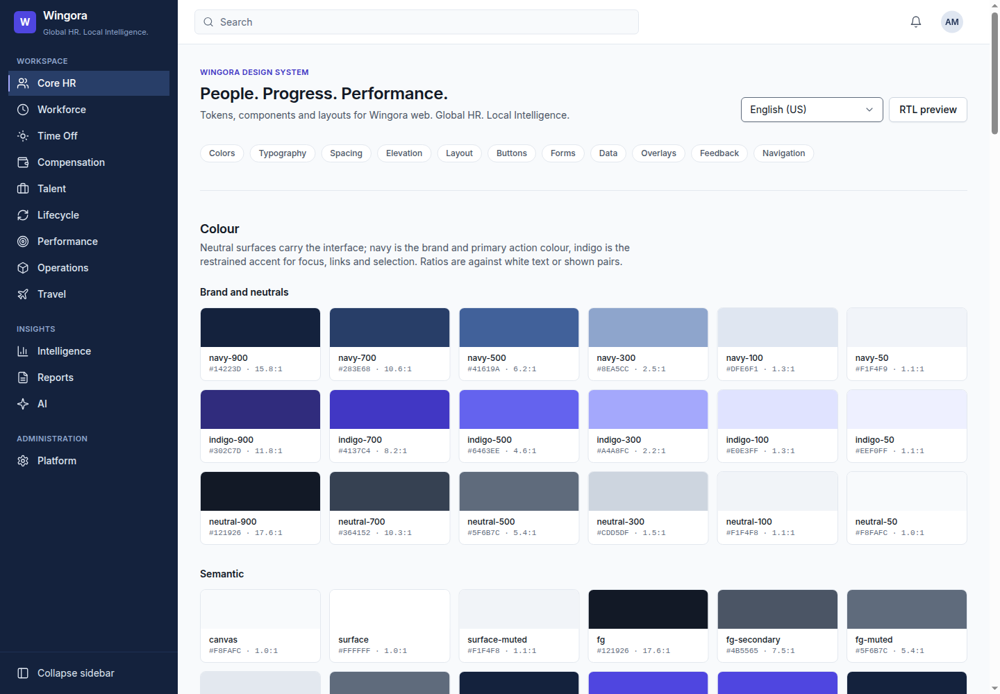
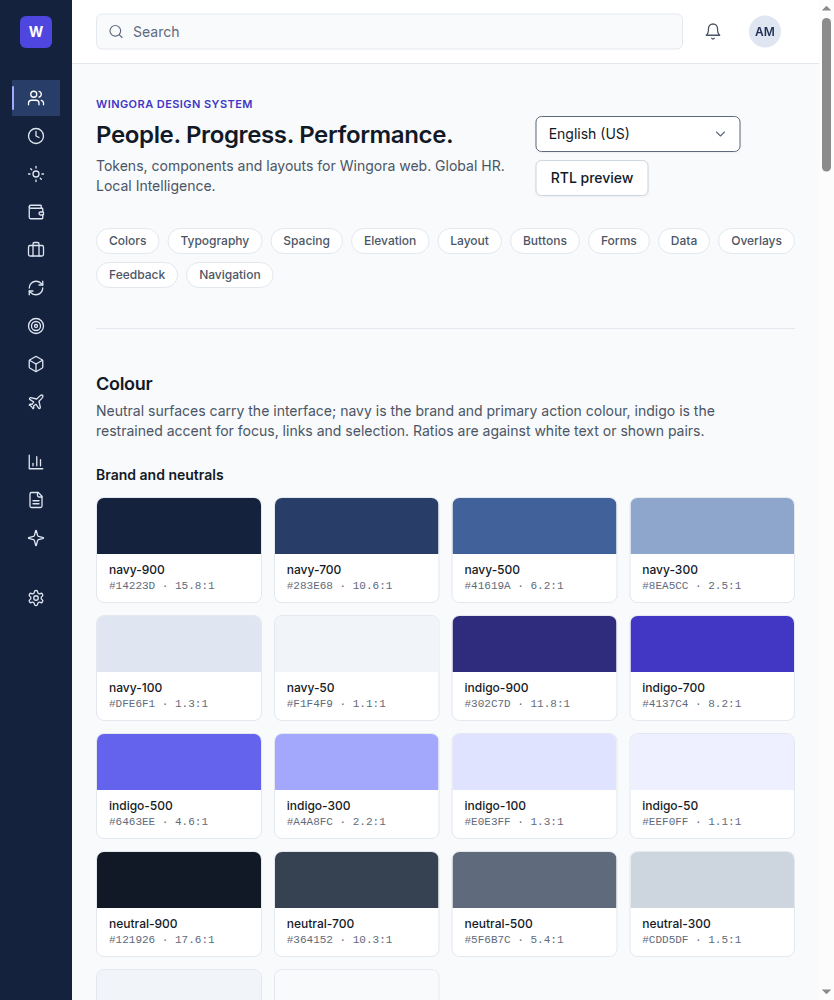
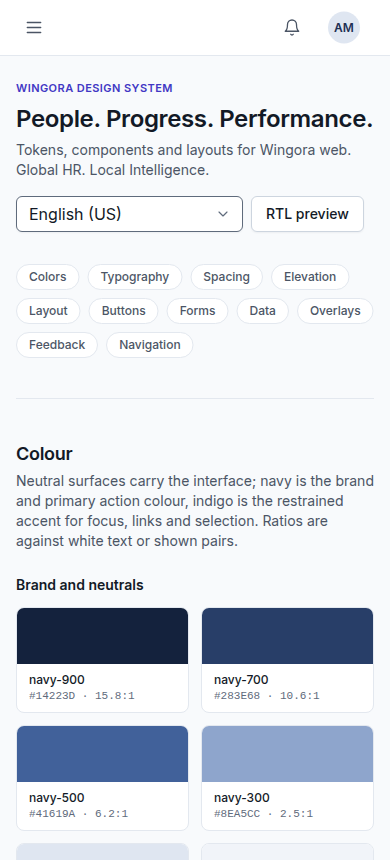

# Wingora design system

**Wingora: People. Progress. Performance.** Global HR. Local Intelligence.

Premium enterprise SaaS: minimalist, light, sharp type, clear hierarchy, white and neutral surfaces, with navy and indigo used as restrained accents.

| Where | What |
| --- | --- |
| `packages/design-tokens` | Platform-agnostic tokens (TypeScript), WCAG contrast checks, generated Tailwind v4 theme (`css/tokens.css`) |
| `packages/localization` | `en`/`es` catalogs (Arabic and French planned), translator, text direction |
| `apps/web/src/components/ui` | React components (web only, per AGENTS.md section 17) |
| `apps/web/src/shell` | Application layout and `PageHeader` (see [web-shell.md](web-shell.md)) |
| `apps/web/src/design-system` | Live reference page (`pnpm dev`, then open http://localhost:5173) |

| Desktop (≥ 1024px) | Tablet (768–1023px) | Mobile web (< 768px) |
| --- | --- | --- |
|  |  |  |

## Principles

1. **Tokens only.** Tailwind's default colours, shadows, radii, type sizes, breakpoints and containers are cleared (`--color-*: initial`, …), so only Wingora tokens can be used in class names. No hex values or magic numbers in components.
2. **Neutral first.** Surfaces are white and neutral.
   - Navy (`primary`) marks brand and primary actions; indigo (`accent`) marks focus, links, selection and the active tab.
   - Status colours appear only in badges, alerts and toasts.
3. **One primary action per view.** Destructive actions use `danger` and always go through `ConfirmationDialog`.
4. **Accessible by construction.**
   - Text contrast is ≥ 4.5:1 and UI elements ≥ 3:1. This is verified in `tokens.test.ts`.
   - Every control has a visible label, focus is always visible, and every component works with the keyboard.
   - Meaning is never carried by colour alone.
5. **Logical properties** (`ms-`, `pe-`, `start-`, `end-`) everywhere, so RTL (Arabic) mirrors automatically. The reference page has an RTL preview.
6. **Lightweight.**
   - Runtime dependencies are React only; there is no UI-kit, popper, date or icon library.
   - Icons are inline SVG. Fonts use the system UI stack, with Inter if available; none are bundled.
   - The whole reference page is 91 KB of gzipped JS and 8 KB of CSS (budget: 200 KB per route).

## Tokens

All tokens are in `packages/design-tokens/src`. After editing them, run `pnpm tokens` to regenerate `css/tokens.css`. A test fails if the generated file is stale.

| Group | Tokens | Tailwind usage |
| --- | --- | --- |
| Colour palettes | `neutral`, `navy`, `indigo` 50–950; status bases | `bg-navy-900`, `text-indigo-700` (rarely needed directly) |
| Semantic colour | `canvas`, `surface`, `surface-muted`, `surface-hover`, `surface-selected`, `overlay`; `fg`, `fg-secondary`, `fg-muted`, `fg-disabled`, `fg-inverse`, `fg-link`, `fg-brand`; `line`, `line-strong`, `line-control`, `focus`; `primary(-hover/-active)`, `on-primary`; `accent(-hover/-subtle/-fg)`, `on-accent`; `nav-*` | `bg-surface text-fg border-line` |
| Status | `success`, `warning`, `danger`, `info`, `neutral` × `subtle`, `line`, `fg`, `solid` | `bg-success-subtle text-success-fg` |
| Typography | `font-sans`, `font-mono`; `text-2xs` (11px) … `text-4xl` (36px) with line heights; `tracking-tight/normal/wide`; named `textStyles` | `text-sm font-medium` |
| Spacing | 4px grid (`--spacing: 0.25rem`) | `p-4 gap-3` |
| Radius | `none`, `sm` 4, `md` 6, `lg` 8, `xl` 12, `2xl` 16, `full` | `rounded-md` |
| Shadows | `xs`, `sm`, `md`, `lg`, `xl` (soft, slate-tinted) | `shadow-xs` |
| Layout widths | `page-max` 1440, `content` 1280, `prose` 672, `form` 640, `sidebar` 256 / `sidebar-collapsed` 72, `header` 64 / `header-mobile` 56, `modal-*` and `drawer-*` 400/560/720, `toast` 360, `menu-min` 192 | `max-w-(--container-prose)` |
| Breakpoints | `sm` 640, `md` 768, `lg` 1024, `xl` 1280, `2xl` 1536 | `md:`, `lg:` |
| Z-index and motion | `--z-dropdown/sticky/drawer/modal/toast`; `--duration-fast/base/slow`; `ease-standard`, `ease-exit`. Motion is disabled under `prefers-reduced-motion` | `z-(--z-modal)` |
| Components | `--control-*`, `--button-*`, `--checkbox-size`, `--table-*`, `--card-*`, `--modal-*`, `--toast-*`, `--nav-*` | `h-(--button-height-md)` |

**Sizes:**
- Buttons and controls are 32, 36 and 44 px tall (`sm`, `md`, `lg`). Use `lg` for touch targets (44 px).
- Control text is 16 px below 640 px wide, which prevents iOS from zooming on focus.

## Components

All components live in `apps/web/src/components/ui`, one kebab-case file per component, exported from `index.ts`. Common rules:
- Props are typed.
- Native elements are used first.
- `forwardRef` is used where a DOM handle is useful.
- Variants come from tokens.
- Default labels come from `@wingora/localization` via `useI18n()`.

| Component | Key props | Accessibility and keyboard |
| --- | --- | --- |
| `Button`, `IconButton` | `variant` primary/secondary/tertiary/danger/link, `size`, `loading`, `leadingIcon`, `fullWidth`; `IconButton` requires `label` | `type="button"` by default; loading sets `aria-busy` and disables the button; icon buttons get an `aria-label` |
| `Input` | `label`, `hint`, `error`, `required`, `optional`, `hideLabel`, `leading`, `trailing`, `size` | `<label for>`; hint and error linked via `aria-describedby`; `aria-invalid`; the error has an icon and text |
| `Select` | `options`, `placeholder` + field props | Native `<select>`, so the keyboard, screen readers and the mobile picker all work |
| `Checkbox` | `label`, `description`, `indeterminate` | Native checkbox; label and description are linked |
| `RadioGroup` | `label`, `options`, `value`/`defaultValue`/`onChange`, `orientation` | `<fieldset>` + `<legend>`; native arrow-key behaviour |
| `DatePicker` | ISO `value` `YYYY-MM-DD`, `min`, `max`, `weekStartsOn` (defaults to the locale) | The typed value is validated. The calendar dialog supports: • Arrows to move by day or week • Home/End for the start/end of the week • PageUp/PageDown by month (with Shift, by year) • Enter to select • Escape to close and return focus Days carry full-date labels via `Intl`, `aria-pressed` for the selected day and `aria-current="date"` for today |
| `DataTable` | `caption`, `columns` (`sortable`, `align`, `hideBelow`, `primary`), `rows`, `getRowId`, `sort`/`onSortChange`, `selectable`, `loading`, `error`/`onRetry`, `empty`, `density`, `stackOnMobile`, `footer` | Semantic `<table>` with a `<caption>`, `scope="col"` headers and `aria-sort`. Row checkboxes are labelled. Loading, empty and error states are built in. Below 768 px, rows become cards using `<dl>` |
| `Pagination` | `page`, `pageCount`, `onPageChange`, `total`, `pageSize` | `<nav aria-label>`, `aria-current="page"`, labelled previous/next buttons; numbers are formatted with `Intl` |
| `Modal` | `open`, `onClose`, `title`, `description`, `footer`, `size`, `initialFocus`, `role` | `role="dialog"` with `aria-modal`, labelled by its title and description. Focus is trapped and restored; Escape closes only the top-most dialog; page scroll is locked; it becomes a bottom sheet on mobile |
| `Drawer` | Modal props + `side` start/end, `size` | Same behaviour as Modal; the side is logical, so it mirrors in RTL |
| `ConfirmationDialog` | `title`, `description`, `onConfirm` (may be async), `tone` | `role="alertdialog"`. Destructive dialogs focus Cancel first, the overlay doesn't close it, and async confirms show a busy state |
| `Tabs` | `label`, `tabs`, `value`/`defaultValue`/`onChange` | WAI-ARIA tabs with roving tabindex. Left/Right (mirrored in RTL), Home and End switch tabs automatically; panels are focusable |
| `Dropdown` | `trigger`, `label`, `items` (item/separator, `tone`), `align` | APG menu button: Enter, Space or ArrowDown open on the first item and ArrowUp on the last. Arrows, Home/End and type-ahead move focus; Escape or Tab close; focus returns to the trigger |
| `ToastProvider`, `useToast` | `toast({ title, description, tone, duration, action })`, `dismiss(id)` | Two live regions are always mounted: polite for most toasts, assertive for danger. Danger toasts stay until dismissed (WCAG 2.2.1); others auto-dismiss after 5 s and pause on hover or focus |
| `Badge` | `tone`, `variant` subtle/solid/outline, `dot`, `size` | The text always carries the meaning; the dot is decorative |
| `Avatar` | `name`, `src`, `size`, `decorative` | `role="img"` labelled with the name; falls back to initials if the image is missing or fails |
| `EmptyState`, `LoadingState`, `ErrorState`, `Skeleton` | `title`, `description`, `action`, `onRetry`, `variant` | Loading uses `role="status"` (polite) and errors use `role="alert"` with a Retry button |
| `Card` | `title`, `description`, `actions`, `footer`, `padding` | Rendered as a `<section>` with a heading |

## Layouts

The application layout (`AppLayout`, documented in [web-shell.md](web-shell.md)) provides:
- A skip link and a labelled main navigation of the modules the user may open, with `aria-current` on the active page.
- A header with workspace selectors, search, notifications and an account menu.
- `<main id="main-content">`.

| Viewport | Navigation | Content padding |
| --- | --- | --- |
| Desktop ≥ 1024px | Full sidebar (256 px), collapsible to a 72 px rail | 32 px; max width 1440 px |
| Tablet 768–1023px | 72 px icon rail; labels available to screen readers and as tooltips | 24 px |
| Mobile < 768px (from 360 px) | 56 px top bar; navigation in a start-side drawer | 16 px |

## Localization

- Components never hard-code user-facing text. Defaults come from `@wingora/localization`; `I18nProvider` sets `<html lang dir>`.
- Numbers and dates are formatted with `Intl` using the active locale.
- The design-system reference page itself is internal documentation, so its sample copy is not localized.

## Quality gates

`pnpm lint` (ESLint and jsx-a11y strict), `pnpm typecheck`, `pnpm test` and `pnpm build`. CI: `.github/workflows/web.yml`. The tests cover:
- Contrast of every token pair, and that the generated CSS is up to date.
- Catalog parity between languages.
- Keyboard behaviour for Modal, Drawer, Tabs, Dropdown and DatePicker.
- Label and description wiring.
- Toast live regions and timing.
- axe checks of the forms, the table and the whole reference page. Colour contrast is excluded from axe because jsdom has no layout; tokens are checked instead.

Automated checks catch only part of WCAG 2.2 AA. No conformance is claimed until a manual audit with screen readers (NVDA, VoiceOver, TalkBack) has been done.

## Not yet included

- Dark theme. The semantic tokens are ready for one, but there are no values yet.
- Self-hosted Inter.
- Combobox and autocomplete, tooltips, file upload and a date range picker.
- Visual regression tests (Playwright).
- A React Native implementation using the same token values.
