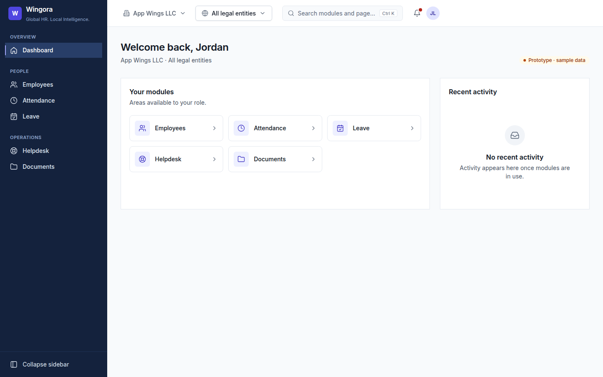

# Web application shell

The responsive frame every Wingora web module renders inside: authentication pages, navigation,
workspace context, search, notifications and error handling. Built only from the design system
([design-system.md](design-system.md)); no new UI library.

## Routes

| Path | Page | Guard |
| --- | --- | --- |
| `/login` | Sign in | Signed-in users go to `/dashboard` |
| `/forgot-password` | Request a reset link | Same |
| `/mfa` | Authenticator or recovery code | Only while a sign-in awaits MFA |
| `/dashboard` … `/billing` | The 16 modules | Signed in **and** module permission |
| `/design-system` | Component preview | Signed in |
| `/access-denied` | 403 | Signed in |
| any other path | 404 | Signed in |

Signed-out users are sent to `/login` and returned to the page they asked for afterwards.
Return targets must be same-origin paths (`safeRedirect`), so the sign-in page cannot be used as an
open redirect.

## Modules and permissions

`@wingora/permissions` is the single list of modules (`modules.ts`) and the permission keys
(`permissions.ts`). Values in `Permission` match the backend `App\Security\Permission` enum exactly.

| Module | Visible with |
| --- | --- |
| Dashboard | `organization.view` |
| Employees | any of `employees.view.all`, `employees.view.department`, `employees.view.self` |
| Payroll | `payroll.view` |
| Reports | `reports.view`* or `audit.view` |
| Settings | any of `organization.manage`, `organization.security.manage`, `users.manage`, `roles.assign` |
| Billing | `billing.view`* **and** `organization.manage` |
| Attendance, Leave, Recruitment, Onboarding, Offboarding, Performance, Assets, Helpdesk, Projects, Documents | `<module>.view`* |

\* `PendingPermission`: not defined by the backend yet. Each must be added to the backend enum and role
catalog with the same value when its module is built. Until then no real user holds them, so those
modules stay hidden outside the prototype.

A module the user lacks is left out of the sidebar, global search, dashboard, breadcrumbs and
notification center. Opening its URL directly renders Access denied in place. Rules fail closed:
an empty or unknown rule denies.

**This is presentation only.** The API authorizes every request with Laravel Policies and tenant
scoping; the client never decides what data a user may read.

## Session

`SessionProvider` keeps the `/api/v1/auth/me` payload (`MeResponse` in `src/auth/types.ts`) in memory.
Nothing about the user is written to `localStorage`/`sessionStorage`; a reload signs out until the
API client restores the session from the Sanctum cookie. Transport is behind `AuthGateway`, matching
the backend flow: `login` → `202 {mfa_required}` → `login/mfa` → session.

**Prototype:** `src/mocks/` holds the only mock gateway and fixtures (three personas, organizations,
legal entities, notifications). They exist for visual prototyping and are replaced by
`@wingora/api-client`; no other backend responses are simulated.

## Layout

| Width | Navigation | Workspace selectors |
| --- | --- | --- |
| ≥ 1024 px | Full sidebar, collapsible to an icon rail | In the top bar |
| 768–1023 px | Icon rail | Above the page content |
| < 768 px | Top bar with a navigation drawer | Above the page content |

- Organization switcher and legal-entity selector are radio menus (`menuitemradio`). The selection is
  UI context only; the server still derives the tenant from the signed-in user.
- Global search: `Ctrl K` / `⌘ K` or the search button opens a combobox dialog over permitted modules
  (arrow keys, Home/End, Enter). People and record search arrive with the module APIs.
- Notification center: a drawer with All/Unread tabs and mark-as-read.

## Loading, errors and empty states

- Every module is a lazy chunk shown behind a `Suspense` loading state; unbuilt modules share the
  `coming-soon` placeholder chunk.
- An `ErrorBoundary`, reset on navigation, wraps the page area so a failing module leaves the shell
  usable and offers Try again. The router `errorElement` catches anything outside it.
- Error pages never display error details. Details go to the console in development only.
- Modules without an API show an empty state rather than invented data.

## Tests

`apps/web/src/app/shell.test.tsx` covers the sign-in → MFA → return flow, validation and focus,
uniform forgot-password response, redirect safety, per-role navigation, direct-URL 403, search and
notification filtering, workspace switching, sign-out, 404, the error boundary and an axe check.
`packages/permissions` tests the permission rules.

## Organization dashboard

`modules/dashboard/` renders `GET /api/v1/dashboard` ([API contract](dashboard.md)). It never computes figures from employee lists, and it shows no figures when the API is unavailable.

- **Data source:** `DashboardSourceProvider` supplies a `DashboardSource`.
  - `httpDashboardSource` calls the API.
  - `disconnectedDashboardSource`, the default, always rejects. The prototype then shows "Live figures need the Wingora API" instead of sample numbers.
  - Tests inject test doubles shaped like the API response.
- **Widgets:** the server decides which widgets the user receives. Any key it leaves out is not rendered. Widgets for modules that aren't built yet (`state: "unavailable"`) show "Available when {module} is connected".
- **Filters:**
  - Country (the four markets).
  - Legal entity, loaded from `GET /api/v1/legal-entities` and narrowed by country.
  - From/to dates using the design-system `DatePicker`.
  - Each change aborts the in-flight request. The previous figures stay on screen, dimmed, until the new ones arrive.
- **States:** a skeleton on first load, an error state with retry, an empty state for roles without headcount access, and an empty state for trends with no data.
- **Charts:** `TrendChart` is plain SVG with a `viewBox`, so it scales with its card. There is no chart library. The SVG is hidden from assistive technology, and a visually hidden table carries the same figures.

### Running against the API

Set `VITE_API_MODE=live` (see `apps/web/.env.example`). The app then uses `createLiveGateway()` for sign-in: Sanctum SPA cookies, `/sanctum/csrf-cookie`, then `/api/v1/auth/login`, `/login/mfa` and `/me`.

`vite dev` and `vite preview` proxy `/api` and `/sanctum` to `WINGORA_API_ORIGIN` (default `http://127.0.0.1:8000`), so cookies stay same-origin. Any other mode is the visual prototype, with mock sign-in and no dashboard figures.

## Not done yet

- Real API client, CSRF cookie bootstrap and session restore on reload.
- Multi-organization accounts (the backend has one organization per user).
- Backend permissions for the pending modules.
- Record-level search, real notifications and the module screens themselves.

## Attendance and leave
`modules/attendance` and `modules/leave` use `api/time.ts` (`TimeSource`, provided in `app.tsx`; disconnected unless `VITE_API_MODE=live`). Tabs appear only for the permissions the server grants. Approve and cancel buttons follow the `can_decide`/`can_cancel` flags the API sends with each request. Times are shown in the employee's zone exactly as the API returns them; the browser never converts them. Leave days are always counted by the server (`/leave/requests/preview`). See `attendance-leave.md`.
